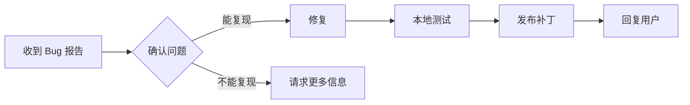

# Tab Settings Enhanced - 产品路线图与维护计划

> 插件的长期发展规划和迭代策略

---

## 📊 版本规划

### 当前版本: v1.0.0 (2026-02)
**状态**: ✅ 已发布

核心功能:
- [x] 新标签位置控制 (5种模式)
- [x] 关闭标签激活策略 (6种模式)
- [x] 父子标签颜色标记 (6种配色)
- [x] 防止重复标签
- [x] 中英双语支持

---

## 🗓️ 版本迭代计划

### v1.1.0 - 体验优化 (2026-03)
**主题**: 用户反馈和体验优化

| 功能 | 优先级 | 工作量 |
|------|--------|--------|
| 标签组折叠/展开 | 🔴高 | 中 |
| 键盘快捷键导航 | 🔴高 | 小 |
| 设置导入/导出 | 🟡中 | 小 |
| 修复社区反馈的 Bug | 🔴高 | - |

**里程碑**: 
- [ ] 收集 20+ 用户反馈
- [ ] 修复所有已知 Bug
- [ ] 添加 2-3 个常见需求功能

---

### v1.2.0 - 高级功能 (2026-04)
**主题**: 高级用户需求

| 功能 | 优先级 | 工作量 |
|------|--------|--------|
| 自定义颜色选择器 | 🟡中 | 中 |
| 标签历史面板 | 🟡中 | 大 |
| 按项目分组标签 | 🟡中 | 大 |
| 右键菜单增强 | 🟢低 | 小 |

---

### v2.0.0 - 大版本 (2026 Q3)
**主题**: 架构升级 + 重大功能

潜在功能:
- 标签工作区 (保存/恢复标签组)
- 与其他插件集成 (Workspaces, Kanban)
- 性能优化 (大量标签场景)
- 设置同步到云端

---

## 📋 功能需求池

### 用户反馈收集渠道
1. GitHub Issues
2. Obsidian Discord
3. 小红书/即刻评论
4. 爱发电支持者反馈

### 需求分类

#### 🔴 高优先级 (影响核心体验)
- [ ] 标签拖拽排序记忆
- [ ] 关闭所有子标签的快捷操作
- [ ] 标签树视图

#### 🟡 中优先级 (常见请求)
- [ ] 标签命名/别名
- [ ] 标签分组锁定
- [ ] 配色方案自定义

#### 🟢 低优先级 (锦上添花)
- [ ] 标签图标
- [ ] 动画效果开关
- [ ] 统计面板 (打开过多少标签等)

---

## 🔧 维护流程

### 日常维护 (每周 1-2 小时)

```
每周一:
□ 检查 GitHub Issues (新增/回复)
□ 检查 Obsidian 更新是否有破坏性变更
□ 回复社区问题

每月一次:
□ 发布补丁版本 (如有 Bug 修复)
□ 更新文档
□ 社区互动 (发帖/感谢)
```

### Bug 修复流程



### 发布检查清单

```markdown
发布前:
- [ ] 更新 manifest.json 版本号
- [ ] 更新 versions.json
- [ ] 更新 CHANGELOG.md
- [ ] 本地完整测试
- [ ] 确认与最新 Obsidian 兼容

发布时:
- [ ] 创建 GitHub Release
- [ ] 上传 main.js, manifest.json
- [ ] 写 Release Notes

发布后:
- [ ] 社交媒体公告
- [ ] 回复等待此更新的用户
```

---

## 📈 增长策略

### 短期 (1-3个月)
1. **提交社区插件**
   - Obsidian 官方插件库申请
   - 完善文档和截图

2. **内容营销**
   - 发布使用教程视频
   - 写深度功能介绍文章
   - 在 PKM 社区分享

3. **用户反馈循环**
   - 主动收集反馈
   - 快速响应 Issue
   - 感谢贡献者

### 中期 (3-6个月)
1. **功能差异化**
   - 对比竞品，找出独特价值
   - 开发 1-2 个杀手级功能

2. **社区建设**
   - Discord 频道运营
   - 中文用户群
   - 贡献者激励

3. **生态整合**
   - 与其他热门插件联动
   - API 开放

### 长期 (6个月+)
1. **可持续发展**
   - 考虑赞助/打赏模式
   - 核心用户社群
   - 代码贡献者培养

---

## 🎯 成功指标

| 指标 | 3个月目标 | 6个月目标 | 1年目标 |
|------|-----------|-----------|---------|
| GitHub Stars | 100 | 300 | 1000 |
| 下载量 | 500 | 2000 | 10000 |
| Issue 响应时间 | <48h | <24h | <12h |
| 活跃贡献者 | 1-2 | 3-5 | 5+ |

---

## 📂 代码维护

### 代码质量
- [ ] 添加 TypeScript 类型检查
- [ ] 添加 ESLint 规则
- [ ] 关键函数添加单元测试

### 分支策略
```
main        (稳定发布版)
  └── dev   (开发分支)
       └── feature/xxx  (功能分支)
       └── fix/xxx      (修复分支)
```

### 版本号规则
- **Major (x.0.0)**: 破坏性变更/架构重构
- **Minor (1.x.0)**: 新功能
- **Patch (1.0.x)**: Bug 修复

---

## 📝 每月复盘模板

```markdown
## [月份] 复盘

### 本月完成
- 

### 关键数据
- 新增 Star: 
- 新增下载: 
- Issue 处理: 

### 用户反馈摘要
- 最常见请求: 
- 最严重 Bug: 

### 下月计划
- 
```

---

## 🤝 贡献者管理

### 感谢贡献者
- 在 README 中列出贡献者
- 每个版本 Release Notes 致谢
- 重要贡献者发送小礼物

### 吸引贡献
- 标注 `good first issue`
- 提供清晰的贡献指南
- 积极 Review PR

---

*最后更新: 2026-02-02*
